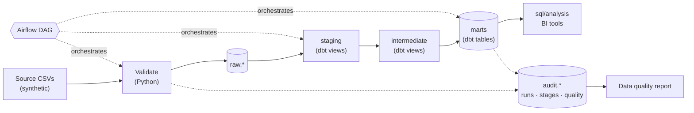
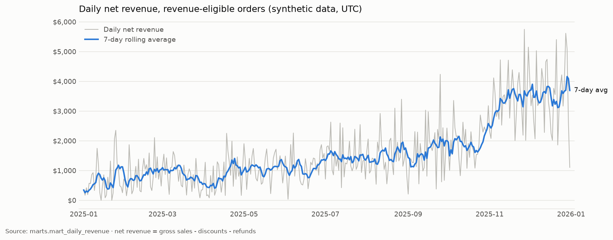

# DataForge — End-to-End Data Engineering Pipeline

A batch data platform for a fictional online marketplace. It ingests order, customer,
product, and payment extracts, validates them, loads them into PostgreSQL, transforms them with
dbt into tested analytical models, and orchestrates the whole flow with Apache Airflow. Every
run leaves an auditable trail and a data quality report.

> This is a production-inspired portfolio project. All data is **synthetic**: it is generated
> deterministically and describes no real company or person.


## Contents

1. [Business problem](#business-problem)
2. [Key engineering capabilities](#key-engineering-capabilities)
3. [Architecture](#architecture)
4. [Technology stack](#technology-stack)
5. [Repository structure](#repository-structure)
6. [Data source](#data-source)
7. [Data model and transformation layers](#data-model-and-transformation-layers)
8. [Prerequisites](#prerequisites)
9. [Configuration](#configuration)
10. [Local setup](#local-setup)
11. [Running ingestion, transformations, and tests](#running-ingestion-transformations-and-tests)
12. [Airflow DAG](#airflow-dag)
13. [Data quality and failure handling](#data-quality-and-failure-handling)
14. [Analytical questions and SQL](#analytical-questions-and-sql)
15. [Screenshots](#screenshots)
16. [Known limitations and possible improvements](#known-limitations-and-possible-improvements)
17. [What this project demonstrates](#what-this-project-demonstrates)

## Business problem

The marketplace receives five extracts from its operational systems: customers, products,
orders, order items, and payment transactions (charges and refunds). Analysts need trustworthy
answers to questions such as:

- How does revenue change over time, daily and month over month?
- Which products and categories generate the most revenue?
- Which customers place repeat orders?
- What share of orders is cancelled or refunded?
- How many orders and customers are processed each day?
- Are there missing, duplicated, invalid, or inconsistent records?
- Did a pipeline run fail, and why?

"Revenue" is ambiguous, so this project uses four precise terms. All of them count only
revenue-eligible orders (`processing`, `shipped`, `delivered`):

| Term | Definition |
| --- | --- |
| Gross sales | `quantity × unit_price` summed over order lines |
| Discounts | Line-level promotional discounts |
| Net sales | Gross sales − discounts |
| Net revenue | Net sales − succeeded refunds |

See [docs/data-dictionary.md](docs/data-dictionary.md) for every metric and column.

## Key engineering capabilities

- **Contract-driven ingestion.** One Python definition of the source schemas
  (`src/dataforge/contracts.py`) drives the generator, the validator, and the raw table DDL.
- **Validation that never drops data.** Invalid rows are quarantined in the raw layer with
  machine-readable reasons and their source line number. Blocking issues stop the pipeline with
  an actionable message.
- **Idempotent loading.** Each run is a batch. Loading replaces the batch atomically in one
  transaction, so retries and reruns never duplicate rows. This is verified by integration tests.
- **Layered dbt project.** Staging, intermediate, and marts layers; enforced model contracts with
  primary keys, foreign keys, and check constraints; 97 data tests; a seed for business rules; and
  macros only where they remove duplication.
- **Lightweight Airflow DAG.** It branches on source availability, uses an explicit retry policy
  (no retries for deterministic data failures), records failures, and runs the same CLI used
  locally and in CI.
- **Observability.** `audit.*` tables record runs, stage attempts, row counts, and every quality
  check. Each run writes a JSON and Markdown report.
- **Verified analytics.** Dbt models are tested against a hand-calculated fixture. Every SQL
  file under `sql/` is executed in integration tests against the real schema.
- **Reproducible environment.** Pinned dependencies, Docker Compose with health checks, and a
  Makefile. CI runs linting, unit tests, integration tests with a PostgreSQL service, DAG tests,
  and a Docker image build.

## Architecture



| Layer | What it does |
| --- | --- |
| Source | Five CSV extracts in `data/source/`. |
| Ingestion | Validates files against contracts, flags invalid rows, and loads each batch atomically into `raw.*`. |
| Staging (dbt) | Keeps the latest valid version per key. Casts types and normalizes identifiers, casing, whitespace, and nulls. |
| Intermediate (dbt) | Reusable logic: priced order lines, payments rolled up per order, enriched orders. |
| Marts (dbt) | `dim_customers`, `dim_products`, `fct_orders`, `fct_order_items`, and four analytical marts. |
| Quality | Source validation, dbt tests, post-load reconciliation, and the persisted report. |
| Orchestration | The Airflow DAG `marketplace_pipeline`. |
| Delivery | Documented marts and runnable SQL in `sql/analysis` and `sql/diagnostics`. |

[docs/architecture.md](docs/architecture.md) covers batch semantics, idempotency, and the
orchestration design in detail.

## Technology stack

| Technology | Version | Why it is here |
| --- | --- | --- |
| Python | 3.12 | Ingestion, validation, quality checks, CLI. 3.12 is supported by both dbt and Airflow 3.3. |
| PostgreSQL | 16 | Warehouse for raw, audit, and modeled data. Also Airflow's metadata database (separate database). |
| pandas | 3.0 | Reads and validates source CSVs column-wise. |
| SQLAlchemy + psycopg2 | 2.1 / 2.9 | Table definitions, parameterized statements, connection handling. |
| dbt Core + dbt-postgres | 1.12 / 1.11 | SQL transformations, tests, contracts, documentation. |
| Apache Airflow | 3.3.2 (LocalExecutor) | Scheduling, dependencies, retries, run history. |
| Docker Compose | v2 | Reproducible local PostgreSQL and Airflow. |
| pytest | 9 | Unit, integration, and DAG tests. |
| Ruff | 0.17 | Python linting and formatting. |
| SQLFluff | 4.4 | SQL linting for dbt models (Jinja templater with dbt builtins) and plain SQL (PostgreSQL dialect). |
| GitHub Actions | – | CI. |
| Make | – | One entry point for common commands. |
| matplotlib (docs extra) | 3.11 | Renders the documentation images from the warehouse. |

`constraints.txt` pins the exact versions that were tested together. dbt and Airflow are
installed in separate environments (see [architecture](docs/architecture.md#why-the-pipeline-runs-in-a-separate-virtualenv-inside-the-airflow-image)).

## Repository structure

```text
.
├── dags/marketplace_pipeline.py        Airflow DAG (thin: calls the dataforge CLI)
├── src/dataforge/
│   ├── contracts.py                    Source schemas: columns, types, keys, accepted values
│   ├── config.py, logging_config.py    Environment-based settings and logging
│   ├── cli.py                          `dataforge` command with one subcommand per stage
│   ├── generation/synthetic.py         Deterministic synthetic data generator
│   ├── validation/                     Parsers, checks, and result types
│   ├── ingestion/loader.py             Atomic batch loading into raw tables
│   ├── database/                       Engine and raw/audit table definitions
│   ├── quality/                        Post-load checks, result storage, report rendering
│   ├── runs.py                         Run and stage tracking in audit tables
│   └── transform.py                    dbt invocation and test-result parsing
├── dbt/marketplace_analytics/
│   ├── models/{staging,intermediate,marts}/
│   ├── macros/                         latest_valid_records, generate_schema_name
│   ├── seeds/order_statuses.csv        Revenue-eligibility rule
│   ├── tests/                          Singular tests and the non_negative generic test
│   └── profiles.yml                    Reads all connection settings from env vars
├── sql/analysis/                       KPI queries for analysts and BI tools
├── sql/diagnostics/                    Duplicate, orphan, quarantine, and run-failure queries
├── tests/{unit,integration,dags}/      pytest suites; fixtures/ holds a hand-built dataset
├── scripts/render_docs_images.py       Renders docs/images from the warehouse
├── docs/                               Architecture, data dictionary, data quality, troubleshooting
├── docker/postgres/                    Creates the Airflow metadata database on first start
├── Dockerfile, docker-compose.yml      Airflow image with the pipeline in an isolated venv
├── Makefile, pyproject.toml, constraints.txt
└── .github/workflows/ci.yml
```

## Data source

The project uses a deterministic synthetic generator instead of a public dataset. It runs
offline, has no licensing questions, and produces exactly the relational edge cases the pipeline
needs: refunds, split payments, failed charges, cancellations after capture, and repeat
customers.

- `make generate-data` writes five CSV files to `data/source/`. With the default seed (42), the
  output is byte-identical on every run; a unit test asserts this.
- Default volume: 1,500 customers, 120 products, 3,817 orders, 7,492 order lines, and 4,352
  payment transactions, covering calendar year 2025 with a seasonal peak in November and
  December.
- Keys and relationships are consistent. Orders are placed after signup. Fulfilled orders are
  paid exactly. Statuses follow the order's age.
- `make generate-defects` adds known-bad records: duplicates, orphans, invalid types and
  statuses, a negative quantity, an order without items, and a payment mismatch. These exercise
  the quality checks.

Details: [data/README.md](data/README.md).

## Data model and transformation layers

| Schema | Objects |
| --- | --- |
| `raw` | `customers`, `products`, `orders`, `order_items`, `payments`: text columns plus `_batch_id`, `_source_line`, `_record_hash`, `_is_rejected`, `_rejection_reasons`, `_loaded_at` |
| `audit` | `pipeline_runs`, `pipeline_stage_runs`, `raw_load_stats`, `data_quality_results` |
| `reference` | `order_statuses` (dbt seed) |
| `staging` | `stg_marketplace__customers`, `__products`, `__orders`, `__order_items`, `__payments` |
| `intermediate` | `int_order_items__priced`, `int_payments__aggregated_to_orders`, `int_orders__enriched` |
| `marts` | `dim_customers`, `dim_products`, `fct_orders`, `fct_order_items`, `mart_daily_revenue`, `mart_product_performance`, `mart_customer_order_summary`, `mart_order_status_refunds` |

Design choices:

- **The raw layer stores text exactly as received.** Type problems surface in validation with
  row-level reasons instead of failing a bulk insert. The original values remain available for
  reprocessing.
- **Staging uses the `latest_valid_records` macro.** It keeps one row per business key: the
  latest version that passed validation.
- **Facts and dimensions use enforced dbt contracts.** PostgreSQL rejects duplicate keys,
  dangling foreign keys, and negative quantities while the table is built.
- **Everything is materialized as views or full tables, not incrementally.** At this data volume,
  a full rebuild takes seconds and avoids incremental edge cases such as late-arriving refunds
  that change older orders.

## Prerequisites

| Tool | Version | Needed for |
| --- | --- | --- |
| Docker Engine with Compose v2 | Engine 24+ (free and open source; Colima or Rancher Desktop also work on macOS/Windows) | PostgreSQL and Airflow |
| Memory available to Docker | 4 GB (Airflow's documented minimum) | Full stack |
| Python | 3.12 (3.13 is allowed; 3.14 is not supported by dbt) | Host-side CLI, tests, dbt |
| GNU Make | any | Convenience commands |

No paid services, external APIs, or private credentials are required.

## Configuration

All settings come from environment variables. Copy the template and replace the placeholders:

```bash
make env          # creates .env from .env.example (git-ignored)
```

| Variable | Default | Purpose |
| --- | --- | --- |
| `DATAFORGE_DB_HOST` / `_PORT` / `_NAME` | `localhost` / `5433` / `marketplace` | Warehouse connection from the host. Containers override host and port. |
| `DATAFORGE_DB_USER` / `_PASSWORD` | – (required) | Warehouse credentials; also used to initialise the PostgreSQL container. |
| `DATAFORGE_MAX_REJECTED_RATIO` | `0.02` | Quarantined share per entity above which loading is blocked. |
| `DATAFORGE_SOURCE_DIR`, `DATAFORGE_REPORT_DIR`, `DATAFORGE_DBT_PROJECT_DIR` | `data/source`, `data/reports`, `dbt/marketplace_analytics` | Paths (set to container paths in the image). |
| `AIRFLOW_DB_USER` / `_PASSWORD` / `_NAME` | – / – / `airflow` | Airflow metadata database. |
| `AIRFLOW_JWT_SECRET` | – (required) | Shared signing secret between Airflow components. |
| `AIRFLOW_HOST_PORT`, `AIRFLOW_UID` | `8080`, `50000` | UI port and container user (use `id -u` on Linux). |

`dataforge` validates the settings at startup and names any missing variable.

## Local setup

```bash
git clone <repository-url> dataforge-end-to-end-data-pipeline
cd dataforge-end-to-end-data-pipeline

make env            # then edit .env and replace every placeholder
make install        # .venv with the project, dbt, dev, and docs extras (pinned)
make db-up          # PostgreSQL only, on localhost:${DATAFORGE_DB_PORT}
make generate-data
make run-pipeline   # validate → load → dbt seed/run/test → quality checks → finalize
```

To run the full stack with Airflow:

```bash
make up             # builds the image; starts PostgreSQL, Airflow API server, scheduler, DAG processor
make trigger        # unpauses and triggers marketplace_pipeline
```

The Airflow UI is at <http://localhost:8080>. The local configuration uses Airflow's simple auth
manager with `SIMPLE_AUTH_MANAGER_ALL_ADMINS=true`, so no login is needed. This is for local
development only.

| Service | Port | Starts after |
| --- | --- | --- |
| `postgres` | `${DATAFORGE_DB_PORT:-5433}` → 5432 | – |
| `airflow-init` (`airflow db migrate`, exits) | – | postgres healthy |
| `airflow-apiserver` (UI and API) | `${AIRFLOW_HOST_PORT:-8080}` | airflow-init completed |
| `airflow-scheduler` | – | airflow-init completed |
| `airflow-dag-processor` | – | airflow-init completed |

| Command | Effect |
| --- | --- |
| `make ps` / `make logs` | Status and health / follow logs |
| `make psql` | SQL shell on the warehouse |
| `make down` | Stop containers and keep volumes |
| `make reset` | Remove containers, volumes, generated data, and reports |

## Running ingestion, transformations, and tests

| Command | What it runs |
| --- | --- |
| `make generate-data` | Synthetic CSVs into `data/source/` |
| `make run-pipeline` | All stages for a new run id, without Airflow |
| `dataforge validate --run-id X` / `dataforge load --run-id X` | One stage at a time (`.venv/bin/dataforge`) |
| `make dbt-parse` | Parse the dbt project (no database needed) |
| `make dbt-seed`, `make dbt-run`, `make dbt-test`, `make dbt-build` | dbt stages |
| `make dbt-docs` | dbt documentation site in the target directory |
| `make demo-defects` | Pipeline on the defect-injected dataset |
| `make lint` | Ruff check, Ruff format check, SQLFluff |
| `make test` | Unit tests (no database, about 1–2 seconds) |
| `make test-integration` | Integration tests against PostgreSQL in a separate `dataforge_test` database |
| `make airflow-venv && make test-dag` | DAG structure tests with Airflow installed |
| `make ci` | Lint, unit tests, and dbt parse |

Test suites:

| Suite | Count | Covers |
| --- | ---: | --- |
| `tests/unit` | 69 | Deterministic generation, parsers, schema/type/required-field validation, duplicates, referential integrity and cascades, reconciliation warnings, threshold blocking, raw row building, configuration, report rendering, seed/contract consistency |
| `tests/integration` | 32 | Idempotent reloads, atomic rollback, quarantine persistence, stage/retry tracking, staging deduplication across batches, hand-calculated revenue/refund/AOV/repeat-rate values, constraint enforcement, dbt tests, post-load checks, every `sql/` file executing |
| `tests/dags` | 10 | DAG configuration, dependencies, branch logic, retry policy, trigger rules |

## Airflow DAG


`marketplace_pipeline` runs daily at 03:00 UTC with `catchup=False` and `max_active_runs=1`:

```text
check_source_availability ─┬─> generate_sample_data ─┐
                           └─────────────────────────┴─> validate_source_files -> load_raw_tables
  -> dbt_seed -> dbt_run -> dbt_test -> run_quality_checks -> publish_pipeline_status
record_pipeline_failure  (trigger rule one_failed, downstream of every stage)
```

- `generate_if_missing` (a DAG param, default `true`) controls whether missing source files are
  generated or fail the run.
- Infrastructure-sensitive tasks retry twice with exponential backoff. Validation, dbt tests,
  and quality checks do not retry, because they fail on data.
- The Airflow `run_id` is the batch id. **Clearing a task or a whole run reprocesses the same
  batch and replaces its data.** A backfill creates new run ids, and staging still keeps one row
  per key.

[Retries, reruns, and backfills](docs/architecture.md#retry-vs-rerun-vs-backfill) are compared
in detail in the architecture document.

## Data quality and failure handling


| Severity | Effect |
| --- | --- |
| blocking | The stage fails with a message naming the check and entity; the run is recorded as failed. |
| error | The row is quarantined: kept in `raw.*` with `_is_rejected` and reasons, and excluded from staging. |
| warning | The row is loaded and the issue is reported. |

Checks cover missing columns, invalid types, nulls in required fields, invalid statuses,
negative or zero values, duplicate keys, orphaned foreign keys (with cascade), orders without
items, payment reconciliation, refunds above charges, and the quarantined share per entity.
After dbt, post-load checks reconcile raw → staging → marts row counts and the revenue totals
across marts.

Each run writes `data/reports/<run_id>/data_quality_report.md` and `.json`. Full catalogue and
an annotated example: [docs/data-quality.md](docs/data-quality.md).
Diagnosis steps: [docs/troubleshooting.md](docs/troubleshooting.md).

## Analytical questions and SQL

Every file runs against the implemented schema, and each one is executed in the integration
tests.

| Question | Query |
| --- | --- |
| How does revenue change daily and monthly? | [`01_daily_and_monthly_revenue.sql`](sql/analysis/01_daily_and_monthly_revenue.sql) |
| Which products and categories perform best? | [`02_top_products_and_categories.sql`](sql/analysis/02_top_products_and_categories.sql) |
| What is the repeat customer rate? | [`03_repeat_customer_rate.sql`](sql/analysis/03_repeat_customer_rate.sql) |
| What is the average order value? | [`04_average_order_value.sql`](sql/analysis/04_average_order_value.sql) |
| What are the cancellation and refund rates? | [`05_cancellation_and_refund_rates.sql`](sql/analysis/05_cancellation_and_refund_rates.sql) |
| How often do customers order? | [`06_customer_order_frequency.sql`](sql/analysis/06_customer_order_frequency.sql) |
| What is the rolling seven-day revenue? | [`07_rolling_seven_day_revenue.sql`](sql/analysis/07_rolling_seven_day_revenue.sql) |
| How does revenue change month over month? | [`08_month_over_month_revenue.sql`](sql/analysis/08_month_over_month_revenue.sql) |
| How many records are processed per run? | [`09_daily_pipeline_volume.sql`](sql/analysis/09_daily_pipeline_volume.sql) |
| Which keys are duplicated, orphaned, or quarantined? Which totals look wrong? Which runs failed? | [`sql/diagnostics/`](sql/diagnostics/) |

Example: the rolling seven-day revenue query.

```sql
select
    revenue_date,
    net_revenue_amount,
    sum(net_revenue_amount) over seven_days as rolling_7d_net_revenue
from marts.mart_daily_revenue
window seven_days as (order by revenue_date rows between 6 preceding and current row)
order by revenue_date;
```

Because `mart_daily_revenue` contains every calendar day, including days without orders, a
row-based window equals a seven-day calendar window.

## Screenshots

| Image | Generated from |
| --- | --- |
|  | `marts.mart_daily_revenue` after a local pipeline run on the synthetic dataset (`make docs-images`) |
| `docs/images/data-quality-quarantine.png` (shown above) | `raw.*` and `audit.raw_load_stats` for the `make demo-defects` run |
| `docs/images/airflow-dag-run.png` (shown above) | Headless-browser screenshot of the local Airflow 3.3 UI after a manual run |
| `docs/images/data-pipeline-architecture.png` | `scripts/render_docs_images.py` |

## Known limitations and possible improvements

- **Snapshot semantics.** Sources are full snapshots without delete markers. A record removed
  from a later extract stays in staging. Real change data capture, or snapshot-diffing with soft
  deletes, would fix this.
- **Backfills reprocess the same files.** Partitioning sources by logical date
  (`data/source/{{ ds }}/`) would make historical runs meaningful.
- **Raw retention.** Raw keeps every batch. A retention job, or partitioning `raw.*` by batch
  date, would bound storage.
- **No incremental models.** This is a deliberate choice at the current volume. At a larger
  scale, `fct_order_items` would become incremental on `order_item_id`, with a lookback window for
  late refunds and a documented `--full-refresh` procedure.
- **Single currency, no shipping or tax lines.** These are documented simplifications of the
  business scenario.
- **Alerting is limited to Airflow task state and the audit tables.** Notifications (email,
  Slack, PagerDuty) are intentionally not configured, because they need external credentials.
- **Local Airflow security.** The simple auth manager with all users as admins is suitable only
  for local development.
- **Schema evolution.** `init-db` creates missing tables but does not migrate existing ones. A
  migration tool such as Alembic would be the next step.
- **Data volume.** The sample is small. Loading uses batched parameterized inserts; PostgreSQL
  `COPY` would be the next step for multi-million-row files.

## What this project demonstrates

For a hiring manager evaluating data engineering skills:

- **Pipeline design.** Layer responsibilities are explicit and dependencies only flow downstream.
  The same code path runs on a laptop, in CI, and under Airflow.
- **Correctness under failure.** Batch reloads are idempotent and atomic. Retries are safe. Every
  stage and attempt is recorded. Failures leave a diagnosable trail instead of silent gaps.
- **Data quality as engineering, not documentation.** Contracts, row-level quarantine with
  reasons, cascading referential checks, blocking thresholds, dbt contracts and tests, and
  cross-layer reconciliation, all persisted per run.
- **Analytics engineering.** A tested dbt project with clear metric definitions (gross vs. net
  sales vs. net revenue), dimensional marts, and SQL that is verified to run.
- **Operational pragmatism.** Pinned and isolated dependencies, health-checked containers,
  CI that exercises a real database, and stated limitations instead of overstated claims.

## License

[MIT](LICENSE)
