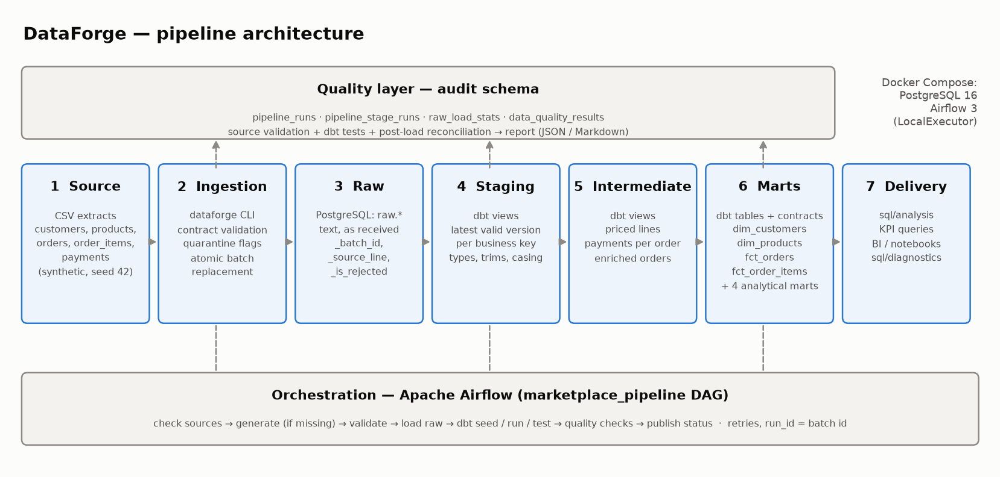
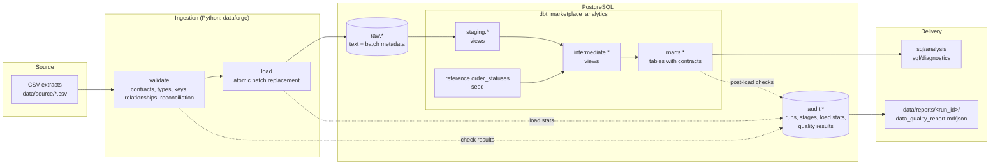
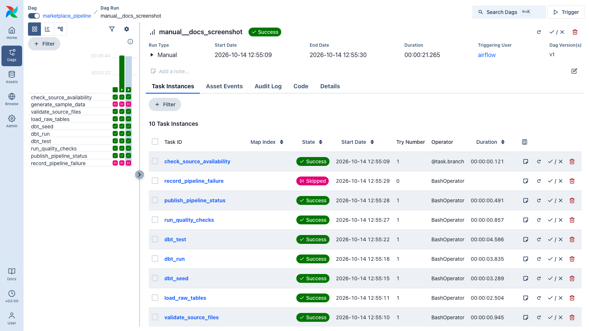
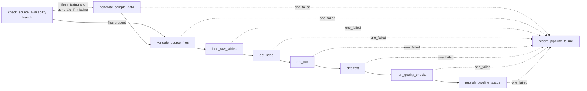

# Architecture

## Layers and dependencies

Dependencies only point downstream. The Python package never reads dbt models except in
post-load checks, which run after dbt has finished. dbt reads only the `raw` source tables and
its own seed.

| Layer | Implementation | Responsibility |
| --- | --- | --- |
| Source | `data/source/*.csv` from `dataforge generate-data` | Five relational extracts, regenerated deterministically (seed 42). |
| Ingestion | `src/dataforge/validation`, `src/dataforge/ingestion` | Validate every file against `contracts.py`. Flag invalid rows with reasons. Load the batch atomically. |
| Raw | `raw.customers`, `raw.products`, `raw.orders`, `raw.order_items`, `raw.payments` | Preserve values exactly as received, as text, with `_batch_id`, `_source_line`, `_record_hash`, `_is_rejected`, and `_rejection_reasons`. |
| Staging | `models/staging/stg_marketplace__*.sql` (views) | Keep the latest valid version of each business key. Cast types, trim, and normalize casing. |
| Intermediate | `models/intermediate/*.sql` (views) | Reusable logic: priced order lines, payments aggregated to orders, enriched orders. |
| Marts | `models/marts/*.sql` (tables) | Dimensions and facts with enforced dbt contracts (primary keys, foreign keys, checks), plus four analytical marts. |
| Quality | `audit.*`, dbt tests, `src/dataforge/quality` | Persist every check result per run and stage. Write a JSON and Markdown report. |
| Orchestration | `dags/marketplace_pipeline.py` | Order the stages, retry transient failures, and record the final run status. |
| Delivery | `sql/analysis`, `sql/diagnostics` | KPI and troubleshooting queries over the marts and the audit tables. |

## Batch identity and idempotency

- **Every run is a batch.** The Airflow `run_id`, or `--run-id` for the CLI, becomes the
  `_batch_id` of every raw row and the key of every audit record.
- **Loading is a controlled batch replacement.** Inside one transaction, the loader takes an
  advisory lock, deletes all rows of the batch from the five raw tables, and inserts the new
  rows. A retry or rerun of the same batch therefore replaces data rather than duplicating it.
  If anything fails, the transaction rolls back and the previous state of the batch remains.
  `tests/integration/test_ingestion.py` covers all three behaviours.
- **Different batches coexist in raw.** That gives an audit trail of what was received and
  when. Staging resolves them with the `latest_valid_records` macro: per business key, it keeps
  the most recently loaded row that is not quarantined.
- **dbt models are rebuilt in full** (views and tables). With a few thousand orders, a full
  rebuild takes seconds, so incremental materialization would add complexity without benefit.
  See *Known limitations* in the README for when that changes.

## Why the pipeline runs in a separate virtualenv inside the Airflow image

Airflow 3.3 pins its own versions of SQLAlchemy, pandas, and many providers. dbt-core pins
different versions of shared libraries. Installing both into one environment is fragile, so the
Dockerfile installs `dataforge` and dbt into `/opt/dataforge-venv`. Airflow tasks call
`$DATAFORGE_CLI <command>` through `BashOperator`. This has three effects:

- DAG parsing imports only Airflow and the standard library. Parsing stays fast and never
  touches the database.
- The same CLI runs on a laptop, in CI, and in Airflow, so behaviour is identical everywhere.
- Upgrading Airflow and upgrading dbt are independent changes.

## Orchestration

The screenshot shows a manual run of `marketplace_pipeline` in the local Airflow 3.3 stack. The
grid on the left also includes earlier runs from the same environment.

| Setting | Value | Reason |
| --- | --- | --- |
| Schedule | `0 3 * * *`, UTC | One daily batch after source systems close the previous day. |
| `catchup` | `False` | Sources are full snapshots, so replaying old intervals adds no information. |
| `max_active_runs` | `1` | Batches must not interleave. The loader's advisory lock is a second guard. |
| Retries | 2, exponential backoff from 2 minutes (capped at 10) | Covers transient database and network errors. |
| No retries | `validate_source_files`, `dbt_test`, `run_quality_checks` | These fail on data, not infrastructure. Retrying would give the same answer later. |
| `execution_timeout` | 30 minutes | Stops a stuck task from holding the only active run slot. |

### Retry vs. rerun vs. backfill

| Action | What happens | Data effect |
| --- | --- | --- |
| **Task retry** (automatic) | Airflow re-executes one failed task instance in the same run. `audit.pipeline_stage_runs.attempt` increments. | The stage repeats with the same `run_id`. Loading replaces the batch, and dbt rebuilds the models. |
| **Rerun / clear a DAG run** (manual) | Clearing tasks in the UI, or with `airflow tasks clear`, re-executes them for the same `run_id`. | Same as a retry: the batch is replaced, never duplicated. Use this after fixing a source file or a bug. |
| **Backfill** (`airflow backfill create --dag-id marketplace_pipeline --from-date ... --to-date ...`) | Creates one new run per historical schedule interval, each with its own `run_id`. | Each run loads the current snapshot under a new batch id. Staging still shows one row per key. |

In this project, a backfill reprocesses the same snapshot and produces no new information. A real
deployment would partition source files by logical date, for example
`data/source/{{ ds }}/orders.csv`, so that each backfilled interval reads its own extract.

## Configuration

All runtime configuration comes from environment variables (see `.env.example`).
`dataforge.config` validates them at startup and names any missing variable. No credentials
appear in code, dbt profiles, or workflow files: `profiles.yml` only references `env_var(...)`.
