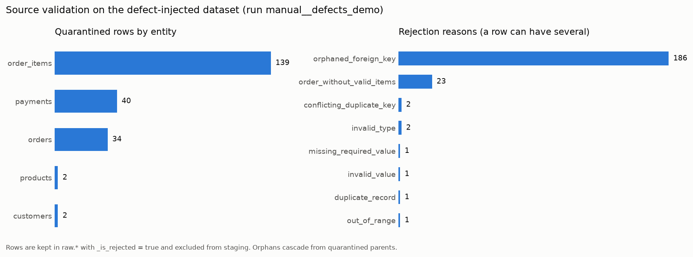

# Data Quality

Quality is checked at three points. Each check result is stored in
`audit.data_quality_results` with its run id, stage, severity, status, and record counts.

| Stage | Where | When |
| --- | --- | --- |
| `source_validation` | `src/dataforge/validation/validator.py` | Before anything is loaded. |
| `dbt_test` | dbt generic and singular tests | After `dbt run`. Results are parsed from `run_results.json`. |
| `post_load` | `src/dataforge/quality/post_load.py` | After dbt. Reconciles raw → staging → marts and revenue totals. |

## Severities and failure handling

| Severity | Effect | Examples |
| --- | --- | --- |
| **blocking** | The stage fails and the Airflow task fails. Downstream tasks do not run. `record_pipeline_failure` marks the run as failed. | Missing file, missing required column, header-only file, quarantined share above `DATAFORGE_MAX_REJECTED_RATIO` (default 2%), failed dbt `error` test, staging/mart row counts that do not reconcile. |
| **error** | The row is **quarantined**. It is stored in `raw.*` with `_is_rejected = true` and reasons, and excluded from staging. The pipeline continues. | Bad type, missing required value, invalid status, negative quantity, duplicate key, orphaned foreign key, order without items. |
| **warning** | The row is kept and the issue is reported. | Malformed email, payments that do not reconcile with the order total, refunds above charges, cancelled orders that still hold captured funds, dbt tests configured with `severity: warn`. |

**Invalid data is never silently discarded.** Quarantined rows stay in the raw layer with their
source line number, so they can be traced back to the delivered file
(`sql/diagnostics/quarantined_records.sql`). They become visible downstream once a corrected
extract is delivered and loaded.

Staging keeps the latest *valid* version of each key. If an updated record arrives invalid, the
previous valid version stays in staging (last known good), and the new row is reported as
quarantined.

## Source validation checks

| Check | Severity | Rule |
| --- | --- | --- |
| `file_present`, `file_readable`, `file_not_empty` | blocking | Each of the five files exists, parses as UTF-8 CSV, and has data rows. |
| `required_columns_present` | blocking | Every contract column exists. |
| `no_unexpected_columns` | warning | Extra columns are ignored and reported. |
| `not_null:<column>` | error | Required columns are non-empty after trimming. |
| `valid_type:<column>` | error | Integers, decimals (≤ 2 places), booleans (`true`/`false`), ISO 8601 timestamps with an offset. |
| `accepted_values:<column>` | error | `order_status`, `payment_status`, `payment_method`, `transaction_type`, `currency`. |
| `range:<column>` | error | `quantity > 0`, `amount > 0`, `line_number ≥ 1`, prices and discounts ≥ 0. |
| `not_in_future:<column>` | error | No timestamp later than the validation time. |
| `discount_not_above_line_total` | error | `discount_amount ≤ quantity * unit_price`. |
| `email_format` | warning | Basic `local@domain.tld` shape. |
| `unique:<primary key>` | error | Exact duplicates: the first copy is kept and the others are quarantined. Conflicting duplicates (same key, different values): every copy is quarantined, because the system cannot tell which is right. |
| `relationship:<fk>-><parent>` | error | The parent key exists *and is valid*. Quarantine cascades: an order whose customer was quarantined is itself quarantined. |
| `order_has_valid_items` | error | Every order keeps at least one valid line. |
| `payments_reconcile_to_order_total` | warning | For revenue-eligible orders, succeeded charges equal the sum of item net amounts (±0.01). |
| `refunds_not_above_charges` | warning | Succeeded refunds ≤ succeeded charges per order. |
| `cancelled_orders_fully_refunded` | warning | Cancelled orders hold no net captured funds. |
| `rejected_ratio_within_threshold` | blocking | Quarantined share per entity ≤ `DATAFORGE_MAX_REJECTED_RATIO`. |

## dbt tests

The dbt project contains 97 data tests. On the clean sample dataset they pass, as recorded in the
`dbt_test` stage. They include:

- `unique` and `not_null` on every primary key in staging, intermediate, and marts.
- `accepted_values` for order status, payment status, payment method, transaction type,
  currency, refund status, and customer segment.
- `relationships` between orders/customers, items/orders, items/products, payments/orders, and
  between facts and dimensions.
- `non_negative` (a custom generic test in `tests/generic/`) on quantities and amounts.
- Singular business-rule tests:
  - `assert_fct_orders_net_revenue_formula`
  - `assert_order_lines_sum_to_order_totals`
  - `assert_daily_revenue_reconciles_to_fct_orders`
  - `assert_every_order_has_items`
  - `assert_refunds_do_not_exceed_captured` (warn)
  - `assert_revenue_orders_fully_paid` (warn)

## Post-load checks

| Check | Severity |
| --- | --- |
| `batch_present_in_raw` (per entity) | blocking |
| `staging_row_count_matches_raw`: distinct valid raw keys = staging rows (per entity) | blocking |
| `<mart>_row_count_matches_staging` for dimensions and facts | blocking |
| `daily_revenue_reconciles_to_fct_orders` | blocking |
| `product_performance_reconciles_to_fct_order_items` | blocking |
| `eligible_orders_fully_paid` | warning |

## Report

`dataforge quality-check` and `dataforge finalize` write
`data/reports/<run_id>/data_quality_report.{json,md}`. The report contains records loaded per
entity, a summary per stage, and every failed check with its record count and message. Overall
status is `passed`, `passed_with_issues` (only warnings or quarantined rows), or `failed` (any
blocking failure).

### Example: defect-injected dataset

`make demo-defects` generates the sample dataset with deliberately broken records and runs the
whole pipeline on it. The following is an excerpt of the report from a local run:

| Entity | Received | Valid | Quarantined |
| --- | ---: | ---: | ---: |
| customers | 1501 | 1499 | 2 |
| order_items | 7490 | 7351 | 139 |
| orders | 3818 | 3784 | 34 |
| payments | 4352 | 4312 | 40 |
| products | 121 | 119 | 2 |

| Stage | Checks | Passed | Failed |
| --- | ---: | ---: | ---: |
| source_validation | 91 | 77 | 14 |
| dbt_test | 97 | 96 | 1 |
| post_load | 17 | 16 | 1 |

Eleven injected defects cause 237 quarantined rows. Most of them are cascades:

- One product row has a conflicting duplicate key, so both copies are quarantined. The 121 order
  lines that reference that product become orphans.
- One customer has an empty email, so that customer's orders and their lines and payments are
  quarantined.

All quarantined shares stay below the 2% threshold, so the run completes as
`passed_with_issues`.

The remaining failures are warnings:

- The dbt test `assert_revenue_orders_fully_paid` and the post-load check
  `eligible_orders_fully_paid` both catch the payment that was inflated by 5.00.
- At the source validation stage, `payments_reconcile_to_order_total` reports 100 orders.
  These are orders whose charges no longer match their remaining valid lines after the
  quarantine cascades.

Lowering the threshold makes the same run fail at `validate_source_files`, for example:
`DATAFORGE_MAX_REJECTED_RATIO=0.01 make demo-defects`.
